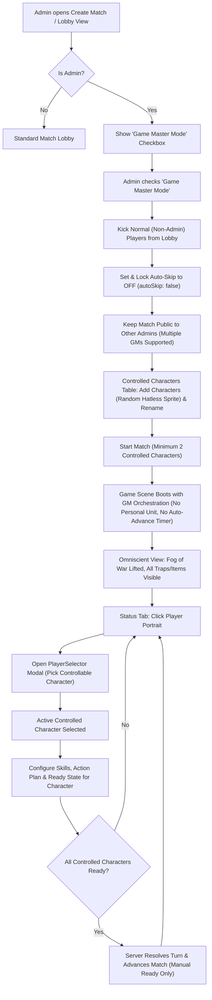

# Game Master Mode Plan

## Goal

Introduce an **Admin-Only Game Master Mode** allowing administrators to orchestrate and play out an entire match by controlling every character on the board. In this mode:
- The match is **not** private; other administrators can enter, allowing **multiple Game Masters** to participate and manage the match together.
- Non-admin (normal) players are kicked automatically when switching to Game Master mode in the lobby, and non-admins are blocked from joining.
- The Game Masters do not control personal avatars; instead, they manage a roster of controlled characters from the lobby through the match lifecycle, planning moves, upgrading skills, setting readiness per character, and observing the game world with omniscient visibility ("Admin View Everything").
- Switching between controlled characters in-game is initiated directly from the **Status tab** in the character panel: clicking the character's sprite portrait opens a character selector modal (leveraging the existing `PlayerSelector` modal component) to choose any controllable character.
- **Autoskip is strictly turned off** (`autoSkip: false`) in Game Master mode. The match never advances turns due to round timer expiration, giving Game Masters unlimited time to plan actions, allocate skills, and coordinate moves across all controlled characters.

This is a design and architecture plan only; no application code changes are included.

---

## Current Behavior and Relevant Implementation

### 1. Match Creation & Lobby Workflow
- Match creation is initiated via `client/src/scenes/MainScene.ts` calling the `create_match` RPC, which initializes a `MatchRecord` with default settings and auto-joins the creator via `join_match`.
- Lobby configuration is handled in `client/src/scenes/LobbyView.ts`, offering steppers for player capacity, grid dimensions, skip times, auto-skip toggle (`autoSkipToggle`), and AI bots (`botPlayers`).
- The player roster is rendered via `client/src/ui/LobbyPlayerCard.ts`, which displays avatar containers (`PlayerSkinRenderer.ts`), badges, names, and Elo.

### 2. Character Model & Spawning
- In standard matches, each joined human user and AI bot (`bot1`, `bot2`, ...) gets a corresponding `PlayerCharacter` entry in `match.playerCharacters`, keyed by user/bot ID (`server/modules/src/utils/playerCharacter.ts`).
- When `start_match` is invoked (`server/modules/src/rpc/startMatch.ts` and `server/modules/src/match/startMatchRecord.ts`), `assignSpawnPositions` and `distributeTeams` place all participants onto walkable map tiles and assign secret/cover teams.

### 3. Action Planning & Turn Advancement
- Turn actions are planned client-side in `client/src/scenes/ActionPlanSynchronizer.ts` and saved via RPCs:
  - `update_main_action` (`server/modules/src/rpc/updateMainAction.ts`)
  - `update_secondary_action` (`server/modules/src/rpc/updateSecondaryAction.ts`)
  - `upgrade_skill` (`server/modules/src/rpc/upgradeSkill.ts`)
  - `buy_shop_item` (`server/modules/src/rpc/buyShopItem.ts`)
- All action and skill RPCs currently assume `ctx.userId` is the actor and look up `match.playerCharacters[ctx.userId]`.
- Readiness is submitted via `update_ready_state` (`server/modules/src/rpc/updateReadyState.ts`), which sets `match.readyStates[ctx.userId]`. A turn advances automatically when all active players in `match.players` are marked ready or incapacitated.
- In standard matches, when `match.autoSkip !== false`, the Nakama match loop (`server/modules/src/match/async_turn/loop.ts`) checks elapsed turn time against round time and automatically executes `advanceTurn` if a player has moved or the grace period has elapsed.

### 4. Admin Privileges & Full Visibility
- Admin status is verified server-side with `isAdminUser(nk, userId)` checking user metadata (`server/modules/src/utils/admin.ts`).
- Full match visibility ("Admin View Everything") is implemented in `server/modules/src/utils/matchView.ts` via `tailorMatchForPlayer(match, viewerId, viewAll)`. When `viewAll = true`:
  - Fog of war is lifted (full map tiles revealed).
  - All ground items, placed traps, and hidden C4s are visible regardless of ownership.
  - All player characters, statuses, and true teams are visible without line-of-sight concealment.

### 5. Existing Character Selector Component & Status Portrait
- `client/src/ui/panel/CharacterPanelStatusView.ts` renders the current character's composite sprite portrait via `createSkinContainer` at `(layout.margin + layout.portraitSize / 2, layout.contentTop + layout.portraitSize / 2)`.
- `client/src/ui/PlayerSelector.ts` implements a character selection system wrapping `GridSelect`. It is already used across `CharacterPanelLogView` and `CharacterPanelShopView` to present modal grids with character portraits, names, and labels.

---

## Architecture & Workflow Proposal



### A. Admin Privilege, Multi-GM Access & Non-Admin Kick
1. **Lobby Checkbox**:
   - Add a labeled checkbox/toggle `Game Master Mode` to `client/src/scenes/LobbyView.ts`.
   - Gated strictly by user account privileges: visible and interactive only when `account.isAdmin === true`. Non-admin players cannot see or enable this option.
2. **Server-Side Enforcement**:
   - Both `create_match` and `update_settings` RPCs validate incoming `game_master_mode: true` flags against `isAdminUser(nk, ctx.userId)`. Non-admin attempts are rejected with permission denied (`Codes.PERMISSION_DENIED`).
3. **Kicking Normal (Non-Admin) Players on Toggle**:
   - When Game Master Mode is toggled on (in `update_settings`), the server inspects all participants currently in `match.players`.
   - Any player who is not an administrator (`!isAdminUser(nk, playerId)`) is immediately removed/kicked from `match.players` and notified via match signal (`OPCODE_PLAYER_KICKED` / `kicked_reason: "gm_mode_enabled"`).
4. **Public to Admins (Multi-GM Support)**:
   - The match does **not** become private when Game Master mode is enabled (`is_private` remains configurable or false).
   - In `join_match`, any authenticated admin (`isAdminUser(nk, ctx.userId)`) is permitted to enter as an additional Game Master.
   - Non-admin players attempting to join a Game Master match are rejected with `Codes.PERMISSION_DENIED` ("Game Master matches are restricted to administrators").
   - Multiple Game Masters share control over the character roster and can collaborate simultaneously.

### B. Controlled Characters Roster & Match Settings in Create Match / Lobby View
1. **UI Presentation & Auto-Skip Lock**:
   - When Game Master Mode is checked, the standard "Bots" stepper and player count stepper are hidden or locked.
   - **Autoskip Disabled**: The Auto-Skip toggle (`autoSkipToggle`) in `LobbyView.ts` is automatically toggled to `false` and locked/disabled. Game Master mode requires deliberate execution where turns only advance once the GM has set readiness for all characters.
   - A dedicated **Controlled Characters Table** is displayed in place of the normal player waiting list, adhering to the visual language of `client/src/ui/LobbyPlayerCard.ts`.
2. **Table Rows & Controls**:
   - Each row presents:
     - Avatar box featuring the composite character sprite (`PlayerSkinRenderer.ts`).
     - Character name display with an inline edit/rename button (invoking the standard text-prompt dialog).
     - Character index badge (e.g. `Character #1`, `Character #2`).
     - Remove row button (enabled whenever character count exceeds the minimum of 2).
3. **Random Sprite Generation (No Hat)**:
   - Clicking **"Add Character"** appends a new character to the table.
   - Sprite generation creates a randomized `Skin` complying with `shared/src/SkinOptions.ts`:
     - `body`: random choice from `BODY_OPTIONS`.
     - `shoes`: random choice from `SHOES_OPTIONS`.
     - `shirt`: random choice from `SHIRT_OPTIONS`.
     - `hair`: random choice from `HAIR_OPTIONS`.
     - `hat`: explicitly empty (`""`).
   - Default name generated sequentially or thematically (e.g., `Character 1`, `Character 2`, or randomized from character names).
4. **Validation to Start**:
   - Minimum characters required: **2** (game cannot start with fewer).
   - Maximum characters bounded by walkable tiles on the chosen map size (`hasEnoughSpawnTiles`).

### C. Match Initialization (`start_match`)
1. **Spawning & Teams**:
   - `server/modules/src/match/startMatchRecord.ts` initializes `match.playerCharacters` using the controlled characters roster (`gm_char_1`, `gm_char_2`, ...).
   - All participating admins are registered in `match.gameMasterUserIds: string[]`. **No personal avatar or unit is spawned on the board for any Game Master**.
   - Spawn positions and secret/cover team distributions are assigned among the controlled characters.
2. **Autoskip Suppression**:
   - `match.autoSkip` is explicitly persisted as `false`.
   - The Nakama match loop (`server/modules/src/match/async_turn/loop.ts`) skips auto-advance evaluations since `match.autoSkip === false`. No auto-skip or AFK resolution will run.

### D. In-Game Master Orchestration (`GameScene` & `CharacterPanelStatusView`)
1. **Omniscient Admin Visibility**:
   - In Game Master matches, client queries (`getState`, `update_ready_state`, `get_replay`) automatically apply `view_all = true` for all joined Game Masters.
   - Fog of war, hidden trap/C4 filters, and stealth concealments are lifted, rendering the full tactical state to all GMs.
2. **Character Selection via Status Tab Portrait Modal**:
   - In `client/src/ui/panel/CharacterPanelStatusView.ts`, the player sprite portrait is made interactive (pointer cursor, click ripple, or subtle hover highlight/selector cue).
   - Clicking the sprite portrait opens a character selection modal backed by the existing `PlayerSelector` / `GridSelect` system.
   - The modal displays:
     - Avatar thumbnail for each controlled character.
     - Character name and index.
     - Current HP bar, energy, and alive/incapacitated status.
     - Readiness indicator (green badge if ready, amber/gray if pending).
   - Selecting a character closes the modal and switches the active controlled character ID:
     - The Status tab instantly updates the portrait, name, health bar, and energy bar to the selected character.
     - The Actions tab, Skills tab, Shop tab, and Inventory tab dynamically rebind to the newly selected character.
   - Hotkeys (e.g. `1`..`N` or `Tab`) remain available as convenience shortcuts, but clicking the portrait modal in the Status tab provides the primary, intuitive visual selection mechanism.
3. **Multi-Game Master Collaboration & State Sync**:
   - When multiple Game Masters are connected, action updates, skill allocations, and ready-state changes made by one GM are broadcast via match signals to all connected GMs, keeping client UI synchronizers aligned.
4. **Character-Scoped Actions & Skills**:
   - When a GM submits skill upgrades, movement destinations, main actions, secondary actions, or shop purchases, the client sends `target_character_id: activeCharacterId`.
   - `ActionPlanSynchronizer.ts` caches planning buffers per character so switching between characters does not lose uncommitted action plans.
5. **Per-Character Readiness, No Autoskip & Turn Advance**:
   - The Ready toggle in `CharacterPanel` marks the *currently selected character* as ready (`target_character_id`).
   - Because `autoSkip` is strictly turned off in Game Master mode, turns never auto-advance or time out due to timer expiration.
   - The server evaluates `allReady` as: **all living, non-incapacitated controlled characters have `readyStates[characterId] === true`**.
   - Once all active controlled characters are ready, the turn advances automatically, resetting readiness for the next round.

---

## Data and Contract Changes

### 1. Shared Types (`shared/src/`)
- **`shared/src/match.ts`**:
  ```typescript
  export interface MatchRecord {
    // ...existing properties
    gameMasterMode?: boolean;
    gameMasterUserIds?: string[];
    controlledCharacterRoster?: Array<{
      id: string;
      name: string;
      skin: Skin;
    }>;
  }
  ```
- **`shared/src/Payloads.ts`**:
  - `CreateMatchPayload` / `UpdateSettingsPayload`: add `gameMasterMode?: boolean` and `controlledCharacterRoster?: Array<{ id: string; name: string; skin: Skin }>`.
  - `UpdateMainActionPayload`, `UpdateSecondaryActionPayload`, `UpgradeSkillPayload`, `BuyShopItemPayload`, `UpdateReadyStatePayload`:
    Add optional `target_character_id?: string`.

### 2. Server RPCs (`server/modules/src/rpc/`)
- **`createMatch.ts`**:
  - Validates `gameMasterMode` against `isAdminUser(nk, ctx.userId)`.
  - Sets `match.gameMasterMode = true`, `match.gameMasterUserIds = [ctx.userId]`, and enforces `match.autoSkip = false`.
- **`updateSettings.ts`**:
  - When `gameMasterMode` is toggled on:
    - Verifies caller is an admin.
    - Scans `match.players` and kicks any non-admin (`!isAdminUser(nk, playerId)`), emitting `OPCODE_PLAYER_KICKED`.
    - Enforces `match.autoSkip = false`.
    - Updates `match.gameMasterMode` and `controlledCharacterRoster`.
- **`joinMatch.ts`**:
  - When `match.gameMasterMode` is true:
    - Verifies `isAdminUser(nk, ctx.userId)`.
    - If admin: appends `ctx.userId` to `match.gameMasterUserIds` and `match.players`.
    - If non-admin: rejects with `Codes.PERMISSION_DENIED`.
- **`startMatch.ts`**:
  - In GM mode, populates `match.playerCharacters` exclusively from `controlledCharacterRoster`.
  - Does not spawn units for any user in `match.gameMasterUserIds`.
  - Explicitly ensures `match.autoSkip = false` is maintained on the active match state.
- **`updateMainAction.ts`, `updateSecondaryAction.ts`, `upgradeSkill.ts`, `buyShopItem.ts`**:
  - In GM mode: verify `match.gameMasterUserIds.includes(ctx.userId)`, resolve `character = match.playerCharacters[json.target_character_id]`.
- **`updateReadyState.ts`**:
  - In GM mode: verify GM caller, update `match.readyStates[json.target_character_id] = ready`.
  - Check `allReady` against all active controlled characters in `match.playerCharacters`.
  - Enforce `viewAll = true` in response payload.

### 3. Client Services & UI (`client/src/`)
- **Random Skin Generator Helper**:
  - Create utility `generateRandomSkinWithoutHat()` picking random options from `SKIN_OPTIONS` with `hat: ""`.
- **`client/src/scenes/LobbyView.ts`**:
  - GM mode toggle visible only to admins.
  - On GM toggle, non-admin players in lobby receive notification and are returned to main menu.
  - Automatically sets `autoSkip` to `false` and disables the `autoSkipToggle` component when GM mode is active.
  - Replace bot/player steppers with Controlled Characters Table (add/rename/remove rows).
- **`client/src/ui/panel/CharacterPanelStatusView.ts`**:
  - Make portrait container clickable in GM mode.
  - Instantiate and wire `PlayerSelector` modal on portrait click.
  - Emit character switch event when a player is selected from the modal.
- **`client/src/ui/panel/CharacterPanel.ts` & `GameScene.ts`**:
  - Bind active controlled character to all tabs (Stats, Actions, Skills, Shop, Inventory).
  - Route action synchronizer and ready toggle to `activeControlledCharacterId`.

---

## Implementation Sequence

1. **Shared Contracts & Validation Helpers**:
   - Update `shared/src/match.ts` with `gameMasterMode`, `gameMasterUserIds`, and `controlledCharacterRoster`.
   - Update action/skill payloads in `shared/src/Payloads.ts` with `target_character_id?: string`.
   - Add random hatless skin generation utility in `shared/src/SkinOptions.ts`.
2. **Server-Side RPC Multi-GM & Non-Admin Kick Logic**:
   - Authorize GM mode in `create_match`, `update_settings`, and `start_match`.
   - In `update_settings`, implement non-admin kick when GM mode is toggled on.
   - In `join_match`, allow admins to join as additional Game Masters, while blocking non-admins.
   - Update action/skill/ready RPCs to accept `target_character_id` for any verified GM in `match.gameMasterUserIds`.
   - Calculate turn readiness based on living, non-incapacitated controlled characters.
3. **Lobby UI (Create Match View)**:
   - Add "Game Master Mode" checkbox to `LobbyView.ts`, visible only to admins.
   - Build Controlled Characters Table matching `LobbyPlayerCard` aesthetic with add, rename, and delete actions.
   - Ensure lobby allows other admins to join while blocking non-admins.
4. **In-Game Status Tab Selector & Character Delegation**:
   - In `CharacterPanelStatusView`, make the player sprite portrait interactive in GM mode.
   - Connect portrait click to open the `PlayerSelector` modal populated with the controlled characters roster.
   - Wire character selection to switch `activeControlledCharacterId` across `CharacterPanel` and `ActionPlanSynchronizer`.
   - Provide visual feedback for ready status and active character in the modal and panel.
   - Maintain omniscient admin visibility ("Admin View Everything") for all joined Game Masters.
5. **Testing & QA**:
   - Validate non-admins are kicked when GM mode is enabled in the lobby.
   - Validate non-admins cannot join a GM match, while additional admins can join and co-master.
   - Verify clicking the portrait in the Status tab opens the character selector modal and cleanly switches controlled characters without dropping pending action plans.
   - Verify all-ready turn advancement resolves once all living controlled characters are ready.

---

## Acceptance Criteria

- **Admin Only**: The "Game Master Mode" toggle is visible and functional only for authenticated admins.
- **Non-Admin Kick on Enable**: When an admin turns on Game Master Mode in the lobby, all non-admin players in the lobby are automatically kicked.
- **Multi-Game Master Access**: The match is not private; other admins can discover and join the match as co-Game Masters. Non-admins cannot join.
- **Lobby Roster Management**: Game Masters can add, remove, and rename controlled characters. New rows receive randomized sprites without hats. Match requires at least 2 characters to start.
- **No Personal Avatar for GMs**: Game Masters do not spawn as units on the board.
- **Status Tab Portrait Character Selector**:
  - In the character panel's Status tab, clicking the character sprite portrait opens a character selector modal (built on `PlayerSelector`).
  - Selecting a character updates the panel to that character's stats, actions, skills, shop, and readiness.
- **Full Turn Orchestration**: Game Masters can allocate skill points, plan actions, and mark readiness for every controlled character.
- **Autoskip Disabled**: In Game Master mode, `autoSkip` is strictly disabled (`false`) both in the lobby settings and on the server. Rounds never auto-advance due to timer expiration, ensuring Game Masters have unlimited time to orchestrate all character actions.
- **Turn Advance Exclusively on All Ready**: The turn resolves and advances only when all living, non-incapacitated controlled characters are marked ready.
- **Omniscient View**: All Game Masters have complete map, trap, item, C4, and true team visibility throughout the match.
- **Multi-GM Synchronization**: Action and ready changes made by any GM sync to all connected GMs in real time.

---

## Risks, Edge Cases & Mitigation

| Risk / Edge Case | Impact | Mitigation Strategy |
| :--- | :--- | :--- |
| **Non-admin attempts to join or forge GM match** | Unauthorized elevation or game disruption | Strict server-side check via `isAdminUser(nk, ctx.userId)` in `join_match`, `create_match`, `update_settings`, and all delegated RPCs. |
| **Non-admin in lobby when GM mode toggled** | Non-admins stranded in GM match | `update_settings` iterates `match.players`, kicks all non-admins, and emits `OPCODE_PLAYER_KICKED`. |
| **Premature turn advance via Autoskip timer** | Game Master loses turn progress while planning multi-character actions if round timer expires | Enforce `autoSkip = false` in `create_match` and `update_settings` whenever `gameMasterMode` is enabled. Match loop strictly ignores auto-advance when `autoSkip === false`. |
| **Multi-GM simultaneous action conflicts** | Race condition where two GMs plan conflicting moves for the same character | Last-write-wins with server timestamp; action synchronizer broadcasts plan updates so other GMs' UIs update immediately. |
| **ActionPlanSynchronizer race conditions on switch** | Actions applied to previous character when switching rapidly | Flush pending debounced action submissions immediately before switching `activeControlledCharacterId`. |
| **All-ready deadlock with dead/incapacitated character** | Match stalls if incapacitated character cannot set ready | Filter incapacitated or dead characters from the mandatory readiness check, matching normal turn advance logic. |
| **Replay & End Game Report compatibility** | Reports expecting standard human winners | Tag match reports with `game_master_mode: true`; present a sandbox/simulation completion banner without altering human player Elo ratings. |
