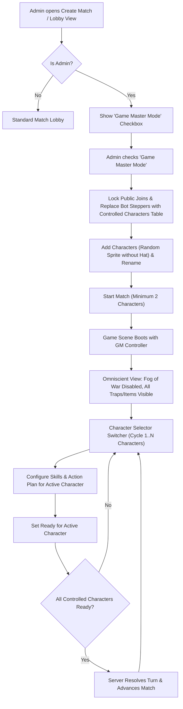

# Game Master Mode Plan

## Goal

Introduce an **Admin-Only Game Master Mode** allowing a single administrator to create, orchestrate, and play out an entire match by controlling every character on the board. The Game Master does not control a personal avatar; instead, they manage a roster of controlled characters from the lobby through the match lifecycle, planning moves, upgrading skills, setting readiness per character, and observing the game world with omniscient visibility ("Admin View Everything").

This is a design and architecture plan only; no application code changes are included.

---

## Current Behavior and Relevant Implementation

### 1. Match Creation & Lobby Workflow
- Match creation is initiated via `client/src/scenes/MainScene.ts` calling the `create_match` RPC, which initializes a `MatchRecord` with default settings and auto-joins the creator via `join_match`.
- Lobby configuration is handled in `client/src/scenes/LobbyView.ts`, offering steppers for player capacity, grid dimensions, skip times, and AI bots (`botPlayers`).
- The player roster is rendered via `client/src/ui/LobbyPlayerCard.ts`, which displays avatar containers (`PlayerSkinRenderer.ts`), badges, names, and Elo.

### 2. Character Model & Spawning
- In standard matches, each joined human user and AI bot (`bot1`, `bot2`, ...) gets a corresponding `PlayerCharacter` entry in `match.playerCharacters`, keyed by user/bot ID (`server/modules/src/utils/playerCharacter.ts`).
- When `start_match` is invoked (`server/modules/src/rpc/startMatch.ts` and `server/modules/src/match/startMatchRecord.ts`), `assignSpawnPositions` and `distributeTeams` place all participants onto walkable map tiles and assign secret/cover teams.

### 3. Action Planning & Turn Advancement
- Turn actions are planned client-side in `client/src/scenes/ActionPlanSynchronizer.ts` and saved via RPCs:
  - `update_main_action` (`server/modules/src/rpc/updateMainAction.ts`)
  - `update_secondary_action` (`server/modules/src/rpc/updateSecondaryAction.ts`)
  - `upgrade_skill` (`server/modules/src/rpc/upgradeSkill.ts`)
  - `buy_shop_item` (`server/modules/src/rpc/buyShopItem.ts`)
- All action and skill RPCs currently assume `ctx.userId` is the actor and look up `match.playerCharacters[ctx.userId]`.
- Readiness is submitted via `update_ready_state` (`server/modules/src/rpc/updateReadyState.ts`), which sets `match.readyStates[ctx.userId]`. A turn advances automatically when all active players in `match.players` are marked ready or incapacitated.

### 4. Admin Privileges & Full Visibility
- Admin status is verified server-side with `isAdminUser(nk, userId)` checking user metadata (`server/modules/src/utils/admin.ts`).
- Full match visibility ("Admin View Everything") is implemented in `server/modules/src/utils/matchView.ts` via `tailorMatchForPlayer(match, viewerId, viewAll)`. When `viewAll = true`:
  - Fog of war is lifted (full map tiles revealed).
  - All ground items, placed traps, and hidden C4s are visible regardless of ownership.
  - All player characters, statuses, and true teams are visible without line-of-sight concealment.

---

## Architecture & Workflow Proposal



### A. Admin Privilege & Match Creation Gating
1. **Lobby Checkbox**:
   - Add a labeled checkbox/toggle `Game Master Mode` to `client/src/scenes/LobbyView.ts`.
   - Gated strictly by user account privileges: visible/interactive only when `account.isAdmin === true`. Non-admin players cannot see or enable this option.
2. **Server-Side Enforcement**:
   - Both `create_match` and `update_settings` RPCs validate incoming `game_master_mode: true` flags against `isAdminUser(nk, ctx.userId)`. Unauthorized attempts are rejected with permission denied (`Codes.PERMISSION_DENIED`).
3. **Session Exclusivity**:
   - When Game Master Mode is enabled, the match is marked private and non-joinable (`is_private: true`, or blocked in `join_match`). The game master is the sole registered user in `match.players`.

### B. Controlled Characters Roster in Create Match / Lobby View
1. **UI Presentation**:
   - When Game Master Mode is checked, the standard "Bots" stepper and player count stepper are hidden or locked.
   - A dedicated **Controlled Characters Table** is displayed in place of the normal player waiting list, adhering to the visual language of `client/src/ui/LobbyPlayerCard.ts`.
2. **Table Rows & Controls**:
   - Each row presents:
     - Avatar box featuring the composite character sprite (`PlayerSkinRenderer.ts`).
     - Character name display with an inline edit/rename button (invoking the standard text-prompt dialog).
     - Character index badge (e.g. `Character #1`, `Character #2`).
     - Remove row button (enabled whenever character count exceeds minimum).
3. **Random Sprite Generation (No Hat)**:
   - Clicking **"Add Character"** appends a new character to the table.
   - Sprite generation creates a randomized `Skin` complying with `shared/src/SkinOptions.ts`:
     - `body`: random choice from `BODY_OPTIONS`.
     - `shoes`: random choice from `SHOES_OPTIONS`.
     - `shirt`: random choice from `SHIRT_OPTIONS`.
     - `hair`: random choice from `HAIR_OPTIONS`.
     - `hat`: explicitly empty (`""`).
   - Default name generated sequentially or thematically (e.g., `Character 1`, `Character 2`, or randomized from character names).
4. **Validation to Start**:
   - Minimum characters required: **2** (game cannot start with fewer).
   - Maximum characters bounded by walkable tiles on the chosen map size (`hasEnoughSpawnTiles`).

### C. Match Initialization (`start_match`)
1. **Spawning & Teams**:
   - `server/modules/src/match/startMatchRecord.ts` initializes `match.playerCharacters` using the controlled characters roster (`gm_char_1`, `gm_char_2`, ...).
   - The Game Master user (`ctx.userId`) is recorded in `match.gameMasterUserId`, but **no character avatar is created for the GM**.
   - Spawn positions and secret/cover team distributions are assigned among the controlled characters.

### D. In-Game Master Orchestration (`GameScene`)
1. **Omniscient Admin Visibility**:
   - In Game Master matches, client queries (`getState`, `update_ready_state`, `get_replay`) automatically apply `view_all = true`.
   - Fog of war, hidden trap/C4 filters, and stealth concealments are lifted, rendering the full tactical state to the Game Master.
2. **Character Selector Component**:
   - A persistent, high-visibility switcher bar is rendered in `client/src/scenes/GameScene.ts` (docked above or beside the `CharacterPanel`).
   - Displays all living and incapacitated controlled characters with:
     - Avatar icon thumbnail.
     - Character name.
     - Health bar and current conditions.
     - Readiness status (green check for ready, amber/gray for pending).
   - Supports mouse selection and hotkey navigation (e.g., numeric keys `1`–`9` or `Tab` / `Shift+Tab`) to quickly cycle between characters.
   - Optional toggle to auto-pan the camera to the selected character's position upon switching.
3. **Character-Scoped Actions & Skills**:
   - `CharacterPanel` updates its tabs (Stats, Actions, Skills, Shop, Inventory) to reflect the currently selected controlled character.
   - When the GM submits skill upgrades, movement destinations, main actions, secondary actions, or shop items, the client passes `target_character_id: activeCharacterId`.
   - Action synchronizer (`ActionPlanSynchronizer.ts`) maintains action planning buffers per character so changing focus does not lose uncommitted selections.
4. **Per-Character Readiness & Turn Advance**:
   - The Ready toggle in `CharacterPanel` marks the *currently selected character* as ready.
   - When toggled ready, the character selector updates to show the character as ready, and the UI can automatically focus the next non-ready character.
   - The server evaluates `allReady` as: **all living, non-incapacitated controlled characters have `readyStates[characterId] === true`**.
   - Once all characters are ready, the turn advances, resetting readiness and allowing the GM to review events and plan the next turn.

---

## Data and Contract Changes

### 1. Shared Types (`shared/src/`)
- **`shared/src/match.ts`**:
  ```typescript
  export interface MatchRecord {
    // ...existing properties
    gameMasterMode?: boolean;
    gameMasterUserId?: string;
    controlledCharacterRoster?: Array<{
      id: string;
      name: string;
      skin: Skin;
    }>;
  }
  ```
- **`shared/src/Payloads.ts`**:
  - `CreateMatchPayload` / `UpdateSettingsPayload`: add `gameMasterMode?: boolean` and `controlledCharacterRoster?: Array<{ id: string; name: string; skin: Skin }>`.
  - `UpdateMainActionPayload`, `UpdateSecondaryActionPayload`, `UpgradeSkillPayload`, `BuyShopItemPayload`, `UpdateReadyStatePayload`:
    Add optional `target_character_id?: string`.

### 2. Server RPCs (`server/modules/src/rpc/`)
- **`updateSettings.ts` / `createMatch.ts`**:
  - Validate admin credentials via `isAdminUser(nk, ctx.userId)`.
  - Store `gameMasterMode` and `controlledCharacterRoster`.
- **`startMatch.ts`**:
  - In GM mode, populate `match.playerCharacters` from `controlledCharacterRoster` rather than `match.players` + `match.botPlayers`.
  - Omit `ctx.userId` from board placement.
- **`updateMainAction.ts`, `updateSecondaryAction.ts`, `upgradeSkill.ts`, `buyShopItem.ts`**:
  - In GM mode: verify `ctx.userId === match.gameMasterUserId`, resolve `character = match.playerCharacters[json.target_character_id]`.
- **`updateReadyState.ts`**:
  - In GM mode: verify GM caller, update `match.readyStates[json.target_character_id] = ready`.
  - Check `allReady` against all active controlled characters in `match.playerCharacters`.
  - Enforce `viewAll = true` when generating the response payload for the GM.

### 3. Client Services & UI (`client/src/`)
- **Random Skin Generator Helper**:
  - Create a utility `generateRandomSkinWithoutHat()` picking random options from `SKIN_OPTIONS` with `hat: ""`.
- **`client/src/scenes/LobbyView.ts`**:
  - Add GM toggle and Controlled Characters Table with add/remove/rename controls.
- **`client/src/scenes/GameScene.ts`**:
  - Render character selector bar in GM mode.
  - Route action planning, skill choices, and ready states through `activeControlledCharacterId`.

---

## Implementation Sequence

1. **Shared Contracts & Validation Helpers**:
   - Update `shared/src/match.ts` and `shared/src/Payloads.ts` with `gameMasterMode` and `target_character_id`.
   - Add random skin generator utility in `shared/src/SkinOptions.ts` (or client equivalent).
2. **Server-Side RPC Gating & Character Delegation**:
   - Authorize GM mode in `create_match`, `update_settings`, and `start_match`.
   - Update action/skill RPCs (`update_main_action`, `update_secondary_action`, `upgrade_skill`, `buy_shop_item`, `update_ready_state`) to support `target_character_id` when caller is the verified Game Master.
   - Adjust `update_ready_state` all-ready calculation for controlled characters.
3. **Lobby UI (Create Match View)**:
   - Add "Game Master Mode" checkbox to `LobbyView.ts` visible only to admins.
   - Build Controlled Characters Table component matching `LobbyPlayerCard` aesthetic.
   - Implement "Add Character" (with hatless random skin), row deletion, and inline renaming.
4. **In-Game GM UI (GameScene & CharacterPanel)**:
   - Implement the Character Selector component in `GameScene.ts`.
   - Adapt `CharacterPanel` and `ActionPlanSynchronizer` to bind to the active controlled character.
   - Wire character switching, readiness toggling per character, and auto-focusing next pending character.
   - Ensure full admin view ("Admin View Everything") is active throughout the match.
5. **Testing & QA**:
   - Write unit tests for GM RPC authorization, target character action execution, and all-ready turn advancement.
   - Verify non-admins cannot enable GM mode or execute target-character delegations.
   - Validate client layout responsiveness across desktop and mobile form factors.

---

## Acceptance Criteria

- **Admin Only**: The "Game Master Mode" toggle is visible and functional only for authenticated admins; non-admin users cannot activate or join GM matches.
- **Lobby Roster Management**: The Game Master can add, remove, and rename controlled characters in the create match view. New rows receive randomized sprites without hats. Match requires at least 2 characters to start.
- **No Personal Avatar for GM**: The Game Master does not spawn as a unit on the board and does not belong to a playable team.
- **Character Switcher**: The GM can cycle seamlessly between all controlled characters in `GameScene` via mouse click or hotkeys.
- **Full Control**: For every controlled character, the GM can allocate skill points, plan movement/actions, use items, and mark ready.
- **Turn Advance on All Ready**: The turn resolves and advances only when all living controlled characters are marked ready (or via manual skip/timeout).
- **Omniscient View**: The GM has complete map, item, trap, C4, and team visibility throughout the match, identical to enabling the "View Everything" admin setting.
- **Replay & Logs**: All match events and logs are fully accessible to the GM across all turns.

---

## Risks, Edge Cases & Mitigation

| Risk / Edge Case | Impact | Mitigation Strategy |
| :--- | :--- | :--- |
| **Non-admin attempts to forge GM mode** | Unauthorized elevation / match manipulation | Strict server verification via `isAdminUser(nk, ctx.userId)` on creation, setting changes, and every delegated action RPC. |
| **ActionPlanSynchronizer race conditions** | Actions applied to previous character when switching rapidly | Flush pending debounced action submissions immediately before switching the active controlled character ID. |
| **All-ready deadlock with dead/incapacitated character** | Match cannot advance if incapacitated character cannot set ready | Filter incapacitated or dead characters from the mandatory readiness check, matching normal turn advance logic. |
| **Lobby join pollution** | Other players joining a GM choreography match | Mark GM matches private (`is_private: true`) and explicitly reject foreign join requests in `join_match`. |
| **Replay & End Game Report compatibility** | Reports expecting a human winner/loser | Tag match reports with `game_master_mode: true`; present a sandbox/simulation completion banner without altering human player Elo ratings. |
